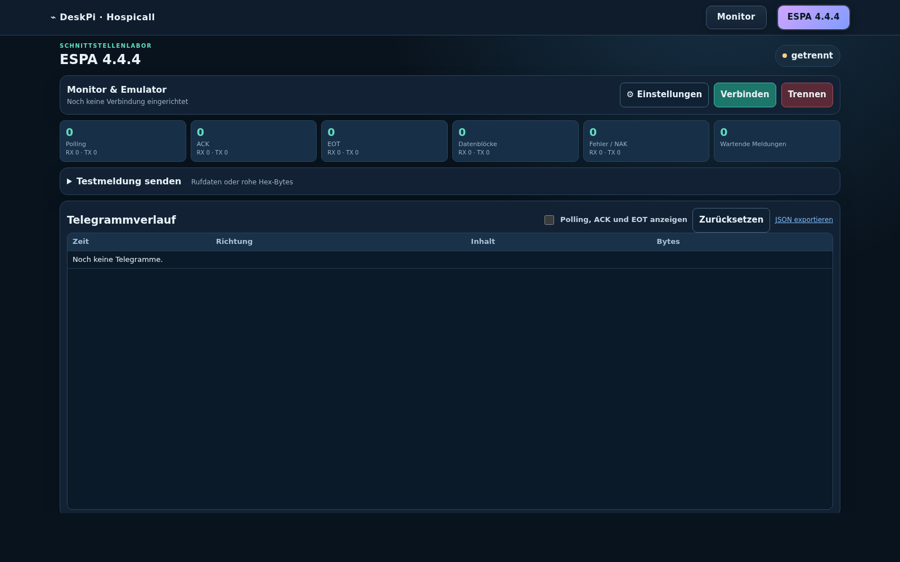

# FreeESPA 4.4.4

Monitor und Emulator für ESPA 4.4.4 unter Windows. Die Oberfläche läuft lokal im Browser; COM-Port und TCP werden direkt von Windows PowerShell angesprochen. Zusätzliche Module und eine separate .NET-Installation sind nicht nötig. Start und Betrieb benötigen keine Administratorrechte.

## Screenshots

Diese Momentaufnahmen zeigen die ESPA-Seite des DeskPi-Monitors vom 16.11.2026; die portable Windows-Fassung nutzt dieselben ESPA-Funktionen.

[Verbindungseinstellungen](docs/screenshots/espa-settings.png) · [Testmeldung senden](docs/screenshots/espa-test.png)

## Start

1. Repository als ZIP herunterladen und entpacken.
2. `Start-FreeESPA.bat` doppelklicken.
3. Im Browser `http://127.0.0.1:8765/` öffnen. Die PowerShell-Konsole muss während der Nutzung offen bleiben.
4. Über **Einstellungen** COM oder TCP wählen und anschließend **Verbinden**.

Der Webserver bindet ausschließlich an `127.0.0.1`. Der ESPA-TCP-Transport kann als Client oder Server betrieben werden. Pro ESPA-Verbindung soll nur eine Seite als Leitstelle/Controller und die andere als Gegenstelle/Device eingestellt sein. Für COM- und TCP-Verbindungen wird erst nach dem Klick auf **Verbinden** eine Verbindung geöffnet. Falls Port 8765 bereits belegt ist, die laufende Instanz im Browser verwenden oder die andere Instanz beenden. Ein alternativer HTTP-Port lässt sich mit `powershell.exe -NoProfile -ExecutionPolicy Bypass -File .\FreeESPA.ps1 -HttpPort 8766` angeben.

## Funktionen

- ESPA-Datenstrom über seriellen COM-Port, TCP-Client oder TCP-Server beobachten
- Baudrate sowie Datenbits, Parität und Stoppbits auswählen
- ESPA-Leitstelle oder Gegenstelle emulieren; Adressen und Polling-Intervall einstellen
- Testmeldungen mit Rufadresse, Text, Signalton, Rufart und Priorität vormerken
- Rohbytes im Emulatorbetrieb manuell senden
- SOH/ETX-Blöcke, Datensatzfelder, Steuerzeichen und BCC-Prüfung für RX und TX dekodieren
- Pollingfehler nach mehr als 20 Sekunden ohne Polling anzeigen und beim nächsten Poll automatisch zurücksetzen
- Polling/ACK/EOT im Verlauf ein- oder ausblenden, getrennte RX/TX-Zähler anzeigen
- Verlauf und Zähler zurücksetzen sowie Mitschnitt als JSON exportieren

Die HTML-Oberfläche aktualisiert den Status jede Sekunde. Die Testmeldung wird in einer Warteschlange gehalten und über den ESPA-Ablauf übertragen. ESPA-Adresse und serielle Parameter müssen zur Gegenstelle passen.

## Voraussetzungen

Windows mit Windows PowerShell 5.1 und der mitgelieferten .NET Framework-Laufzeit. Es werden keine Module installiert und keine Systemeinstellungen geändert. Die Anwendung wurde in dieser Entwicklungsumgebung nicht unter Windows ausgeführt; vor produktivem Anschluss sollte sie mit der konkreten Gegenstelle geprüft werden.

## Lizenz

MIT. Siehe [LICENSE](LICENSE).
